# 👾 Mahmoud Ewis | AI Engineer in Progress

<div align="center">


[](https://git.io/typing-svg)

[](https://github.com/mahmoudewies)
[](https://github.com/mahmoudewies?tab=repositories)


</div>

---

## `01 // SYSTEM IDENTITY`

```bash
┌─────────────────────────────────────────────────────────┐
│  MAHMOUD@GITHUB:~$ whoami                                │
└─────────────────────────────────────────────────────────┘

  NAME       : Mahmoud Ewis
  ROLE       : AI Engineer in Progress
  EDUCATION  : Computer Science & Artificial Intelligence
  UNIVERSITY : Benha University
  LOCATION   : Egypt

  MISSION    : Build intelligent systems that solve
               real-world problems.

  CURRENTLY  : Learning, experimenting, and engineering
               my way toward production-ready AI.
```

I'm a Computer Science and Artificial Intelligence graduate from Benha University, passionate about building practical AI solutions.

My focus is on understanding the complete engineering lifecycle — from data preparation and model development to API integration, containerization, and deployment.

I believe that **an AI model is only part of the solution. Engineering the complete system is what makes it useful.**

---

## `02 // DEVELOPER DNA`

| 🧠 Mindset | ⚙️ Approach | 🎯 Direction |
|---|---|---|
| Continuous Learning | Project-Based Learning | AI Engineering |
| Problem Solving | End-to-End Development | Production AI |
| Experimentation | Building in Public | Real-World Impact |

---

## `03 // AI ENGINEERING RAILWAY`

> Every destination starts with a first commit.  
> This is my learning journey — one station at a time.

### 🚇 THE 90-DAY ENGINEERING EXPRESS

```mermaid
flowchart TD
    START(("🚀 START")) --> S1

    subgraph P1["STATION 01 · DAYS 01–30"]
        S1["01 · PROGRAMMING FOUNDATIONS"]
        S1A["Python · SQL · Git & GitHub"]
        S1B["Data Fundamentals · Mathematics"]
        S1C["Mini Data / ML Project"]
        S1 --> S1A --> S1B --> S1C
    end

    S1C --> S2

    subgraph P2["STATION 02 · DAYS 31–60"]
        S2["02 · MACHINE LEARNING"]
        S2A["NumPy · Pandas"]
        S2B["Scikit-learn · Feature Engineering"]
        S2C["Model Training & Evaluation"]
        S2D["End-to-End ML Project"]
        S2 --> S2A --> S2B --> S2C --> S2D
    end

    S2D --> S3

    subgraph P3["STATION 03 · DAYS 61–75"]
        S3["03 · DEEP LEARNING"]
        S3A["Neural Networks"]
        S3B["PyTorch"]
        S3C["Deep Learning Project"]
        S3 --> S3A --> S3B --> S3C
    end

    S3C --> S4

    subgraph P4["STATION 04 · DAYS 76–90"]
        S4["04 · AI ENGINEERING"]
        S4A["FastAPI · Docker"]
        S4B["Deployment · LLM Fundamentals"]
        S4C["RAG Basics"]
        S4D["Production-Oriented AI Application"]
        S4 --> S4A --> S4B --> S4C --> S4D
    end

    S4D --> DEST(("🏁 AI ENGINEER"))

    style START fill:#542078,color:#fff,stroke:#C084FC
    style DEST fill:#542078,color:#fff,stroke:#C084FC
    style S1 fill:#30134B,color:#fff,stroke:#C084FC
    style S2 fill:#30134B,color:#fff,stroke:#C084FC
    style S3 fill:#30134B,color:#fff,stroke:#C084FC
    style S4 fill:#30134B,color:#fff,stroke:#C084FC
```



### 🚉 Station Progress

| Station | Learning Focus | Status |
|---|---|---|
| 01 | Python, SQL, Git & Foundations | 🟡 In Progress |
| 02 | Data Analysis & Machine Learning | ⚪ Upcoming |
| 03 | Deep Learning & PyTorch | ⚪ Upcoming |
| 04 | APIs, Docker & Deployment | ⚪ Upcoming |
| 🏁 | AI Engineering | 🎯 Destination |

*Progress statuses will be updated as I complete each milestone.*

---

## `04 // CURRENT LEARNING TERMINAL`

```bash
mahmoud@learning:~$ cat current_focus.txt
```

**Current Focus**
- Python programming and problem solving
- SQL and database fundamentals
- Git & GitHub workflow
- Software engineering foundations

**Next Technologies**
- NumPy & Pandas
- Scikit-learn
- Machine Learning workflows
- PyTorch and Deep Learning
- FastAPI and Docker

---

## `05 // TECHNOLOGY UNIVERSE`

<details open>
<summary><b>🐍 Programming & Foundations</b></summary>
<br/>


</details>

<details>
<summary><b>📊 Data & Machine Learning</b></summary>
<br/>


</details>

<details>
<summary><b>🧠 Deep Learning & AI</b></summary>
<br/>


</details>

<details>
<summary><b>🚀 Backend & Deployment</b></summary>
<br/>


</details>

*These technologies represent my learning roadmap and areas of exploration, not a claim of mastery in every tool.*

---

## `06 // PROJECT LAB`

```bash
mahmoud@github:~$ ./show_projects.sh
```

I focus on projects that demonstrate more than just model training — I want to understand the entire journey from problem definition to a working application.

### ⚡ Previous Engineering Work

**Voltify — Smart Home Energy Management**

A mobile-based energy management application combining Flutter, Firebase, Python, and machine learning to help users understand and manage electricity consumption.

**Telco Customer Churn Prediction**

A machine learning project exploring customer churn prediction, feature engineering, model comparison, evaluation, and Streamlit-based deployment.

### 🔬 Upcoming Engineering Missions

- [ ] Data Analysis & ML Foundations Project
- [ ] End-to-End Machine Learning Pipeline
- [ ] Deep Learning with PyTorch
- [ ] AI API with FastAPI
- [ ] Dockerized AI Application
- [ ] Deployed LLM / RAG Application

*Public project repositories and live demos will be linked here as they are published.*

---

## `07 // ENGINEERING PIPELINE`

My goal is to build complete AI systems, not isolated notebooks.


---

## `08 // GITHUB ACTIVITY CENTER`

<div align="center">


<br/>


</div>

---

## `09 // CONTRIBUTION SPACE`

<div align="center">

### 🌌 EVERY COMMIT IS A STEP FORWARD


</div>

---

## `10 // FUTURE DESTINATION`

```bash
mahmoud@github:~$ cat future_vision.txt
```

My long-term goal is to become an AI Engineer capable of:

- Designing and building end-to-end machine learning systems.
- Developing scalable AI-powered applications.
- Working with Deep Learning and modern AI architectures.
- Integrating LLMs and Retrieval-Augmented Generation.
- Deploying, monitoring, and maintaining production AI systems.
- Turning research and ideas into practical engineering solutions.

**The destination is not just knowing AI. It's engineering AI systems that work in the real world.**

---

## `11 // CONNECT WITH ME`

<div align="center">

[](https://github.com/mahmoudewies)
[](https://www.linkedin.com/in/mahmoud-ewis-29a527246/)
[](https://www.kaggle.com/mahmudweso)
[](mailto:mahmoudewis.ai@gmail.com)
[](https://www.facebook.com/profile.php?id=100008224651602)
[](https://www.instagram.com/wesoo.priv/)

<br/>


**`mahmoud@github:~$ echo "The journey is just getting started."`**

<sub>Built with curiosity, consistency, and a lot of commits. 💜</sub>

</div>
