-----------------

 

---

### SYSTEM ONLINE

`MAHMOUD.OS` &nbsp; / &nbsp; `PROFILE CONSOLE` &nbsp; / &nbsp; `EGYPT`

## THE OPERATOR

<table>
<tr>
<td width="60%" valign="top">

### Mahmoud Ewis

**AI Engineer in Progress**

Computer Science & Artificial Intelligence Graduate from Benha University.

I focus on building practical AI solutions and understanding the complete engineering lifecycle — from data preparation and model development to API integration, containerization, and deployment.

My philosophy is simple:

**An AI model is only part of the solution. Engineering the complete system is what makes it useful.**

</td>
<td width="40%" valign="top">

| SYSTEM ATTRIBUTE | VALUE |
|:---|:---|
| `IDENTITY` | Mahmoud Ewis |
| `ROLE` | AI Engineer in Progress |
| `EDUCATION` | CS & AI |
| `UNIVERSITY` | Benha University |
| `LOCATION` | Egypt |
| `MISSION` | Production AI |
| `APPROACH` | Learn / Build / Deploy |
| `STATUS` |  |

</td>
</tr>
</table>

## THE ROUTE MAP

### 🚇 THE 90-DAY ENGINEERING EXPRESS

*One destination. Four major stations. Countless commits.*

```mermaid
flowchart TB
    A(("🚀 DEPARTURE")) --> B

    subgraph S1["01 / FOUNDATION"]
        direction TB
        B["PROGRAMMING FOUNDATIONS"]
        B1["Python · SQL · Git"]
        B2["Data Fundamentals · Mathematics"]
        B3["Mini Data / ML Project"]
        B --> B1 --> B2 --> B3
    end

    B3 --> C

    subgraph S2["02 / INTELLIGENCE"]
        direction TB
        C["MACHINE LEARNING"]
        C1["NumPy · Pandas"]
        C2["Scikit-learn · Feature Engineering"]
        C3["Training · Evaluation"]
        C4["End-to-End ML Project"]
        C --> C1 --> C2 --> C3 --> C4
    end

    C4 --> D

    subgraph S3["03 / NEURAL SYSTEMS"]
        direction TB
        D["DEEP LEARNING"]
        D1["Neural Networks"]
        D2["PyTorch"]
        D3["Deep Learning Project"]
        D --> D1 --> D2 --> D3
    end

    D3 --> E

    subgraph S4["04 / DEPLOYMENT"]
        direction TB
        E["AI ENGINEERING"]
        E1["FastAPI · Docker"]
        E2["Deployment · LLM Fundamentals"]
        E3["RAG Basics"]
        E4["Production-Oriented AI Application"]
        E --> E1 --> E2 --> E3 --> E4
    end

    E4 --> F(("🏁 AI ENGINEER"))

    style A fill:#542078,color:#fff,stroke:#C084FC
    style F fill:#542078,color:#fff,stroke:#C084FC
    style B fill:#30134B,color:#fff,stroke:#C084FC
    style C fill:#30134B,color:#fff,stroke:#C084FC
    style D fill:#30134B,color:#fff,stroke:#C084FC
    style E fill:#30134B,color:#fff,stroke:#C084FC
```

### Station Control

| ROUTE | FOCUS | STATUS |
|:---|:---|:---|
| `ST-01` | Programming & Foundations | 🟡 In Progress |
| `ST-02` | Data Analysis & Machine Learning | ⚪ Upcoming |
| `ST-03` | Deep Learning & PyTorch | ⚪ Upcoming |
| `ST-04` | AI Engineering & Deployment | ⚪ Upcoming |
| `DEST` | Production AI Engineering | 🎯 Target |

90-day learning roadmap. Progress will be updated as milestones are completed.

## CURRENT TRANSMISSION

**CURRENTLY FOCUSED ON**

| NOW | NEXT |
|:---|:---|
| Python programming | NumPy & Pandas |
| SQL & databases | Scikit-learn |
| Git & GitHub | Machine Learning workflows |
| Software engineering foundations | PyTorch & Deep Learning |
| Problem solving | FastAPI & Docker |

## TECHNOLOGY SIGNALS

*Tools I use, technologies I'm learning, and systems I aim to master.*

<b>Programming & Foundations</b>

 

<b>Data & Machine Learning</b>

 

<b>Deep Learning & AI</b>

 

<b>Backend & Deployment</b>

 

Technology badges represent tools used, currently being learned, or included in my engineering roadmap — not a claim of mastery in every technology.

## UPCOMING MISSIONS

*The next systems on my engineering roadmap.*

| MISSION | OBJECTIVE | STATUS |
|:---|:---|:---|
| Data Foundations | Practical data analysis & visualization | Planned |
| ML Pipeline | End-to-end machine learning workflow | Upcoming |
| Neural Systems | Deep Learning with PyTorch | Upcoming |
| AI API | Model serving with FastAPI | Upcoming |
| Containerization | Dockerized AI application | Upcoming |
| RAG Application | LLM integration & retrieval systems | Upcoming |

Each mission will become a practical project with documented implementation and lessons learned.

## THE ENGINEERING PIPELINE

### FROM RAW DATA TO PRODUCTION

**The objective:** Build systems that can be tested, served, deployed, monitored, and improved — not just trained.
## MISSION CONTROL

### GITHUB ANALYTICS

## CONTRIBUTION SPACE

### EVERY COMMIT LEAVES A TRACE

<b>CONTRIBUTION HISTORY</b>

  

<b>CONTRIBUTION SNAKE</b>

 

<b>BUILD. CONTRIBUTE. REPEAT.</b>

Every contribution is another step toward engineering intelligence.

## NORTH STAR

My long-term goal is to become an AI Engineer capable of:

- Designing and building end-to-end Machine Learning systems.
- Developing scalable AI-powered applications.
- Working with Deep Learning and modern AI architectures.
- Integrating LLMs and Retrieval-Augmented Generation.
- Deploying, monitoring, and maintaining production AI systems.
- Turning research and ideas into practical engineering solutions.

> **The destination is not just knowing AI. It's engineering AI systems that work in the real world.**

## ESTABLISH CONNECTION

  

**The journey is just getting started.**

Designed with curiosity. Built with consistency. Powered by commits. 💜

